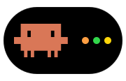
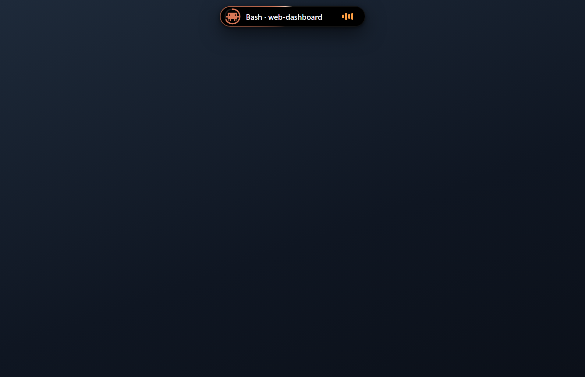
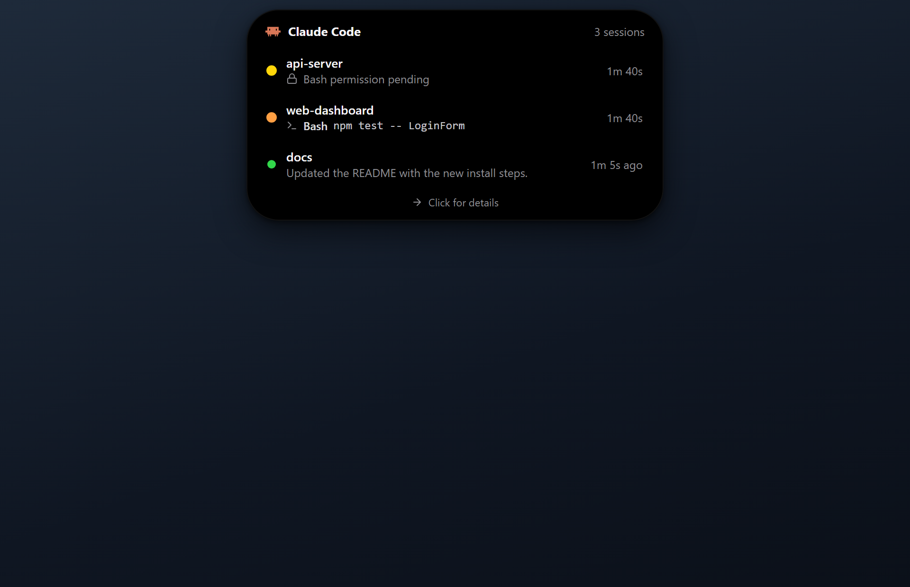
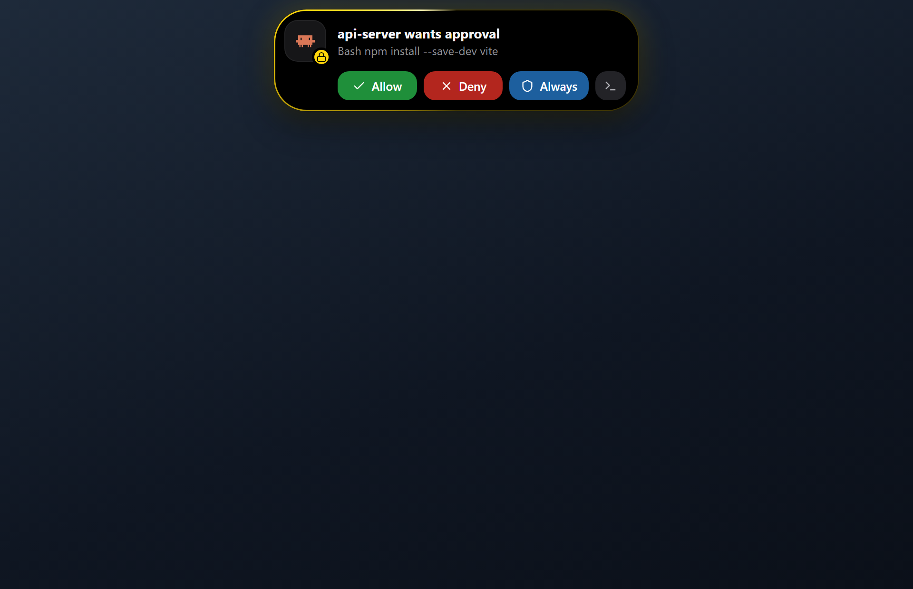
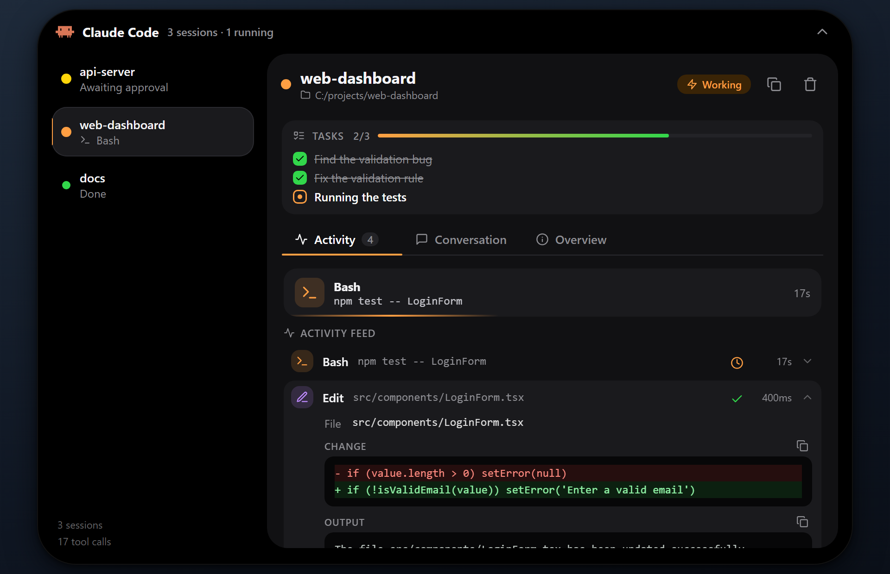

<p align="center">
  
</p>

<p align="center">
  <b>A Dynamic Island-style overlay for Claude Code on Windows.</b><br>
  See what your Claude Code sessions are doing, approve permissions without switching windows, and control Spotify, all from a small capsule at the top of your screen.
</p>

<p align="center">
  <a href="README.tr.md">Türkçe</a> ·
  <a href="CHANGELOG.md">Changelog</a> ·
  <a href="CONTRIBUTING.md">Contributing</a> ·
  <a href="LICENSE">License</a>
</p>

---

## Screenshots

> Screenshots use sample data.

<table>
  <tr>
    <td align="center"><br><sub>Working session in the capsule</sub></td>
    <td align="center"><br><sub>Hover list of all sessions</sub></td>
  </tr>
  <tr>
    <td align="center"><br><sub>Permission request with approve / deny</sub></td>
    <td align="center"><br><sub>Full view with diffs and tasks</sub></td>
  </tr>
</table>

## Features

- **Live session status.** Each Claude Code session is listed with its project name, state (working, awaiting approval, done) and the tool it is running right now. Codex CLI, Gemini CLI and Cursor sessions are supported too (see [Other agents](#other-agents)).
- **Animated mascot.** A pixel-art character that types, reads, runs tests, deploys, waits for you and celebrates, depending on what the agent is doing.
- **Reply from the island.** Send a message to a session's terminal from the full view or straight from the "completed" notification.
- **Approval rules.** Allow or block requests automatically by tool, pattern and project, or add an "always allow in this project" rule from the permission card.
- **History.** Every finished task is kept with its duration, tools, changed files and last message.
- **Permission approvals.** When Claude Code asks for permission, the island expands with the command or edit it wants to run. Allow, deny, "always allow" (when Claude Code suggests a rule) or hand it off to the terminal. Keyboard shortcuts: `Ctrl+Alt+Y` to allow, `Ctrl+Alt+N` to deny.
- **Notifications.** Short, animated alerts when a session finishes, needs your input, or hits an error. A success/error state shows what happened.
- **Full session view.** Click the island to see tool activity with inputs, diffs and output, Claude's latest message, the task list from `TodoWrite`, the conversation, token usage and the files that were touched.
- **Answer questions from the island.** When Claude Code asks with `AskUserQuestion`, the options appear on the island; picking one sends the answer (multi-select works too).
- **Music.** A now-playing card with album art, a progress bar you can click to seek, and previous / play-pause / next buttons. Follows Spotify only, or any player that is playing.
- **Today panel.** Calendar, timer and Claude usage together in the full view.
- **Calendar.** Events from the accounts added to Windows and/or a Google / Outlook / iCloud secret iCal link, with a month grid and a day agenda. A countdown in the capsule 15 minutes before a meeting, alerts 10 minutes before and at the start, and a Join button for Meet / Zoom / Teams links.
- **Timer (Pomodoro).** Linked to Windows focus sessions (Do Not Disturb). 25 / 50 minute focus and 5 minute breaks; a break starts automatically after focus (every 4th break is 15 minutes). The remaining time shows as a ring chip in the capsule.
- **Claude usage.** Tokens for today and the last 7 days, an estimated cost at API prices, a daily chart, and the top projects and models. Calculated from Claude Code's local transcript files.
- **System indicators.** An iOS-style indicator when volume or brightness changes, a battery indicator when the charger is plugged in or out, and low-battery warnings at 20 / 10 / 5%.
- **Games and full-screen video.** The island steps aside while something full-screen runs on its monitor, or shows only approvals.
- **Automatic.** The island starts when a Claude Code session starts, hides when no session is active, and quits itself after a while when it was started that way.
- **English and Turkish.** Follows your system language by default; you can change it from the tray menu.
- **Accessible motion.** Animations can follow the Windows "Show animations" setting, or be turned off from the tray menu.

## Requirements

- Windows 10 or 11
- [Node.js](https://nodejs.org/) 18 or newer
- [Claude Code](https://claude.com/claude-code)
- Optional: the Spotify desktop app, for the music card
- Optional: Visual Studio Build Tools with "Desktop development with C++". `npm install` then compiles `bin/cc-helper.exe`, a small native helper for the music card, system indicators, Windows focus and full-screen detection (a few MB instead of ~80 MB per PowerShell watcher). Without it the app falls back to the PowerShell scripts. Rebuild with `npm run build:native`.

## Installation

Prebuilt Windows download: [Releases](https://github.com/momentxrdd/cc-island/releases/latest). Unzip it, run `CC Island.exe`, then install the hooks as described below (the hooks need [Node.js](https://nodejs.org/)).


```bash
git clone https://github.com/momentxrdd/cc-island.git
cd cc-island
npm install
npm run install-hooks
```

`npm run install-hooks` adds CC Island's hooks to `~/.claude/settings.json` and to every other supported agent it finds on the machine. Before writing, it saves a backup next to each file (`*.ccisland.bak`). Restart any sessions that were already open so they pick up the hooks. To connect a single agent, run `node install-hooks.js --agent=codex` (`claude`, `codex`, `gemini`, `cursor`), or use **Settings → AI tools** in the app.

### Other agents

| Agent | Config file | What works |
| --- | --- | --- |
| Claude Code | `~/.claude/settings.json` | Live status, approvals, questions, transcript |
| OpenAI Codex CLI | `~/.codex/hooks.json` | Live status, approvals (Allow / Deny) |
| Gemini CLI | `~/.gemini/settings.json` | Live status; approvals are answered in the terminal |
| Cursor | `~/.cursor/hooks.json` | Live status (tools as they finish), last reply |

Cline is not supported yet: its hooks do not run on Windows.

To start the island manually:

```bash
npm start
```

You do not need to keep it running yourself. Once the hooks are installed, the island launches when a new Claude Code session starts.

### Uninstall

```bash
npm run uninstall-hooks
```

This removes only CC Island's hook entries and leaves the rest of your settings untouched. Then delete the project folder.

## How it works

```
Claude Code ──hooks──▶ hook.js ──HTTP 127.0.0.1:47321──▶ main.js ──IPC──▶ renderer (island UI)
                                    ▲                       │
                                    └──── permission reply ◀┘

Spotify ──Windows media session──▶ cc-helper.exe (or media.ps1) ──▶ media.js ──▶ main.js
```

- Claude Code runs the hooks defined in `~/.claude/settings.json` on each event (session start, prompt, tool use, permission request, notification, stop, session end).
- `hook.js` forwards each event to the island's local server on `127.0.0.1`. For permission requests it waits for your decision and returns it to Claude Code.
- The Spotify card reads the Windows media session through a small native helper (PowerShell when it is not built), so it works with the desktop app without any API key or login.

## Privacy

- Everything stays on your machine. The island talks only to a server bound to `127.0.0.1`. The one exception is the calendar: if you connect an iCal link, the island downloads that link every 10 minutes. The link is stored in the settings file and never sent to the page.
- The usage summary only reads the transcript files under `~/.claude/projects`; the cost is an estimate at API prices (not your actual bill if you use a subscription).
- To show conversations and token counts, it reads the transcript files Claude Code already writes locally (the path arrives in the hook payload).
- Settings are stored in Electron's user data folder (`%APPDATA%\cc-island\settings.json`).

## Settings

Use the tray icon (right-click):

| Menu | Options |
| --- | --- |
| Language | Automatic (system), English, Türkçe |
| Animations | Always on, Follow Windows setting, Off |
| Sounds | All alerts, Only approvals and questions, Off |
| Music card | Spotify only, Any player, Off |
| Screen | Primary monitor, Monitor with the mouse |
| System indicators | Volume / brightness / battery indicators on or off |
| Start with Windows | Starts the island when you sign in (for calendar alerts) |
| Timer | Focus 25 / 50 min, Break 5 min, Pause, Stop |
| Calendar | Use iCal link from clipboard, Refresh now, Disconnect |
| Full-screen apps | Hide the island, Only approvals and questions, Always show |

Everything else (appearance, mascot, calendar sources, focus sync, approval rules, AI tools) is in the full view under **Settings**.

Demo: show all states plays through every island state so you can see how they look.

## Keyboard shortcuts

| Shortcut | Action |
| --- | --- |
| `Ctrl+Alt+Y` | Allow the oldest pending permission request |
| `Ctrl+Alt+N` | Deny the oldest pending permission request |

These only work while a permission request is pending.

## Troubleshooting

- **The island does not appear.** Check that the hooks are installed (`npm run install-hooks`) and that the session was started after that. Hooks are read when a session starts.
- **Permission approvals fall back to the terminal.** The island was not running when the request came in. Start it with `npm start`, or open a new session so it auto-starts.
- **No Spotify card.** Only the Spotify desktop app is detected. The Windows media controls must show Spotify (the volume flyout lists it when it is playing).
- **Port in use.** The island uses port `47321`. If another program uses it, set `CC_PORT` to a different number before starting, and make the same change in the environment that runs the hooks.
- **Animations look stuck.** Check the "Animations" setting in the tray menu. "Follow Windows setting" disables motion when Windows "Show animations" is off.

## Project structure

See [CONTRIBUTING.md](CONTRIBUTING.md#project-layout) for a file-by-file overview.

## Limitations

- Windows only. The Spotify integration relies on the Windows media session APIs.
- Only one Spotify instance is followed. Other music apps and browser players are not shown.
- The island shows only the primary monitor.

## Trademarks

CC Island is an independent project and is not affiliated with, endorsed by, or sponsored by Anthropic. "Claude" and "Claude Code" are trademarks of Anthropic. The mascot used in the logo and in the interface is a Claude Code asset; please check Anthropic's brand guidelines before reusing it in your own project.

## Credits

The animated mascot comes from [clawd-pet](https://github.com/abderrahimghazali/clawd-pet) by Abderrahim Ghazali (MIT, see `assets/pets/LICENSE`). The files were copied with a uniform `viewBox` so they share one crop.

## License

[MIT](LICENSE)
